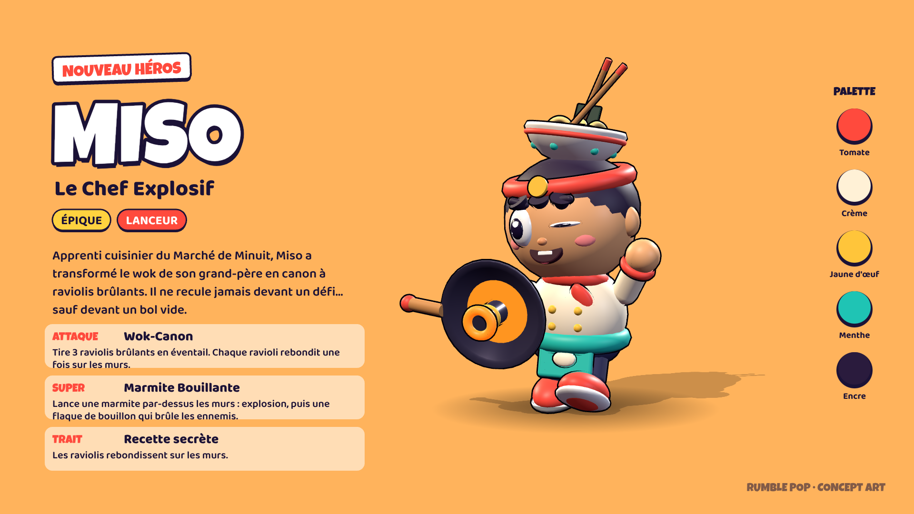

# Rumble Pop

Arène **3 contre 3** en vue de dessus, style cartoon 3D, jouable dans le navigateur (ordinateur et mobile).
Tout est fait en code : les héros sont modélisés en primitives Three.js avec contours encrés, les sons sont synthétisés en WebAudio, et aucune image ni aucun son externe n'est utilisé.



## Jouer

- **Le plus simple** : ouvre `dist/rumble-pop.html` par double-clic. C'est un fichier unique qui marche hors ligne (seules les polices viennent de Google Fonts, avec repli si pas de réseau).
- **Version développement** : sers le dossier avec n'importe quel serveur statique, puis ouvre `index.html` :
  ```bash
  npm start            # ou : python3 -m http.server 8080
  ```
- **GitHub Pages** : active Pages sur la branche, `index.html` est à la racine.

### Commandes

| | Ordinateur | Mobile |
|---|---|---|
| Bouger | ZQSD / WASD / flèches | Joystick à gauche |
| Attaquer | Clic gauche (vers la souris) | Bouton orange : toucher = visée auto, glisser = visée manuelle |
| Super | Clic droit (maintenir pour viser) ou Espace | Bouton jaune, dès qu'il est chargé |
| Pause | Échap | Bouton pause |

### Règles

- 3 munitions qui se rechargent seules ; toucher un ennemi charge le super.
- Après 3 s sans combat, les PV se régénèrent.
- Les buissons cachent les héros, sauf si un ennemi est tout proche ou si le héros vient de tirer.
- **K.O. Express** : la première équipe à 10 K.O. gagne (2 min).
- **Zone Chaude** : rester seuls dans le cercle central remplit la jauge de l'équipe (2 min 30).
- Victoire : +8 trophées pour le héros joué, défaite : −4. Pièces, XP et niveaux sont sauvegardés dans le navigateur.

## Les héros

| Héros | Rôle | Attaque | Super |
|---|---|---|---|
| **Miso** (nouveau) | Lanceur | Wok-Canon : 3 raviolis en éventail qui rebondissent sur les murs | Marmite Bouillante : lancer par-dessus les murs, explosion + flaque brûlante |
| **Volta** | Tireuse d'élite | Rail-Canon : éclair longue portée | Orbe d'Orage : traverse et étourdit |
| **Bouldo** | Tank | Pluie de Cailloux : 5 cailloux en cône | Saut Sismique : bond par-dessus les murs, onde de choc qui repousse |
| **Pluma** | Soutien | Double Graine : 2 tirs rapides | Fleur Guérisseuse : zone de soin pendant 4 s |

### Fiche concept : Miso, le Chef Explosif

Apprenti cuisinier du Marché de Minuit, Miso a transformé le wok de son grand-père en canon à raviolis brûlants.

- **Silhouette** : un bol de ramen porté comme un chapeau, avec baguettes et feuille de nori qui dépassent, plus un énorme wok-canon tenu à bout de bras. On le reconnaît même en tout petit.
- **Tenue** : veste de chef crème à double boutonnage, foulard et bandeau rouges (noués dans le dos, les pans flottent), tablier menthe avec un ravioli brodé, bonbonne de gaz jaune dans le dos, baskets rouges.
- **Personnalité** : grand sourire avec une dent qui dépasse, sourcils décidés, clin d'œil et poing levé dans sa pose de présentation.
- **Palette** : tomate `#ff4a3d`, crème `#fff1d6`, jaune d'œuf `#ffc53a`, menthe `#1fc4b4`, encre `#2a1b3d`.

Dans le jeu, le bouton **Fiche** affiche chaque héros en pose dynamique, vue de trois quarts, sur fond uni avec éclairage studio (lumière principale chaude, débouchage froid, deux contre-jours). Le bouton **Planche PNG** génère une planche 1920×1080 ; les planches des 4 héros sont dans [`concept/`](concept).

## Structure

```
index.html          écrans (lobby, héros, fiche, HUD, résultats)
css/style.css       interface
js/main.js          application, profil, navigation entre écrans
js/heroes.js        modèles 3D des héros, animations, statistiques
js/toon.js          matériaux, contours encrés, géométries partagées
js/game.js          partie : tirs, supers, zones, modes, caméra, HUD
js/ai.js            bots (ciblage, A*, esquive, visée anticipée)
js/arena.js         carte, collisions, ligne de vue, décor
js/lobby.js         scène du lobby
js/showcase.js      fiche concept art + export PNG
js/fx.js            particules
js/audio.js         effets et musique synthétisés
js/input.js         clavier, souris, joysticks tactiles
vendor/             Three.js r160 (licence MIT)
build.mjs           génère dist/rumble-pop.html (npm run build)
```

Rumble Pop est un jeu original : nom, héros, carte et interface ont été créés pour ce projet.
